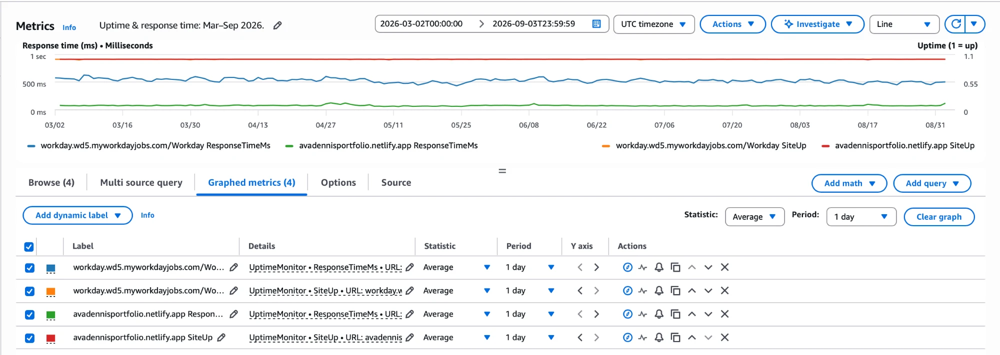
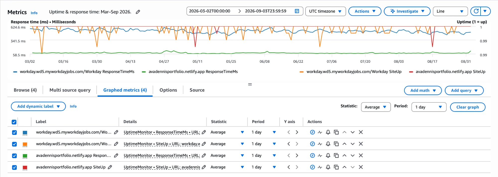
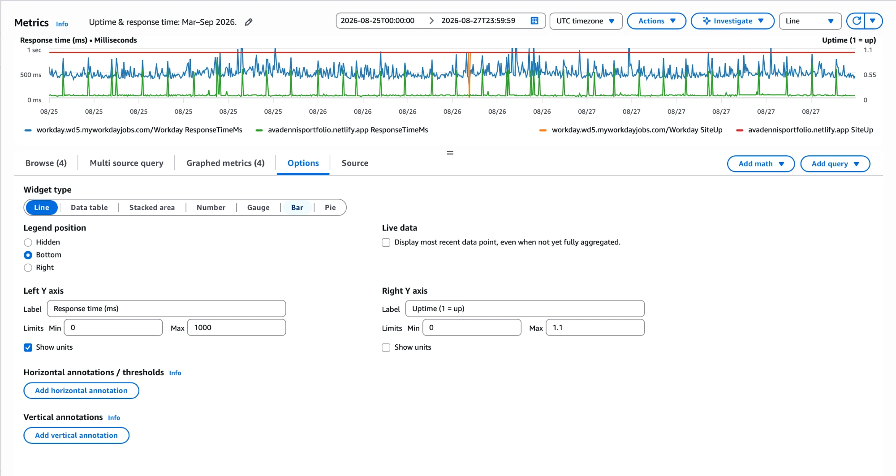
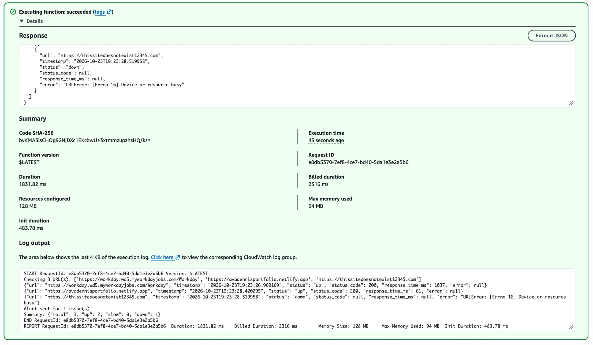
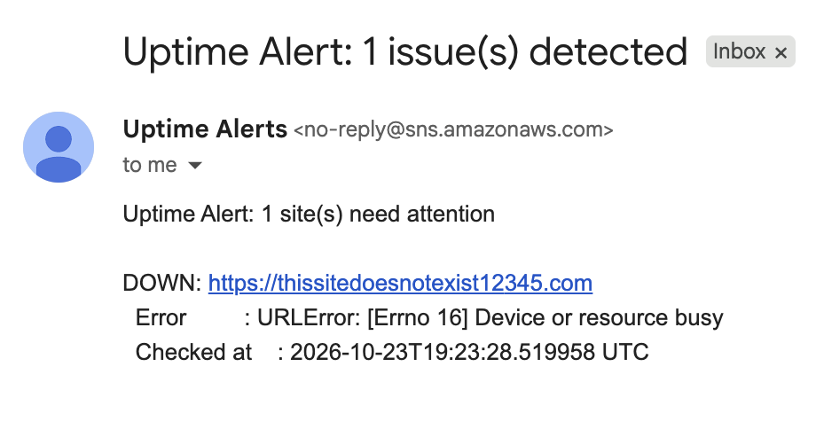
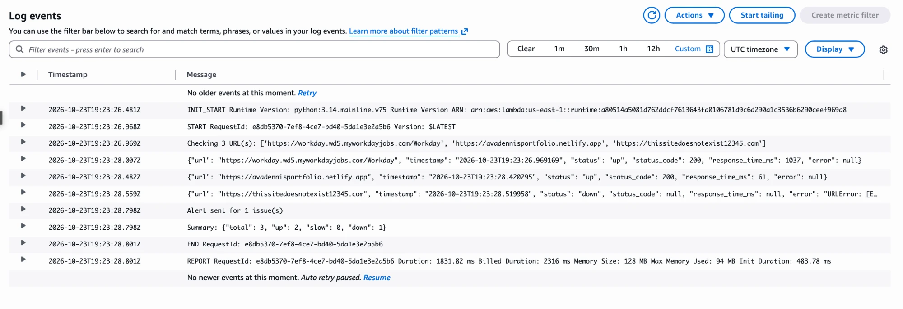
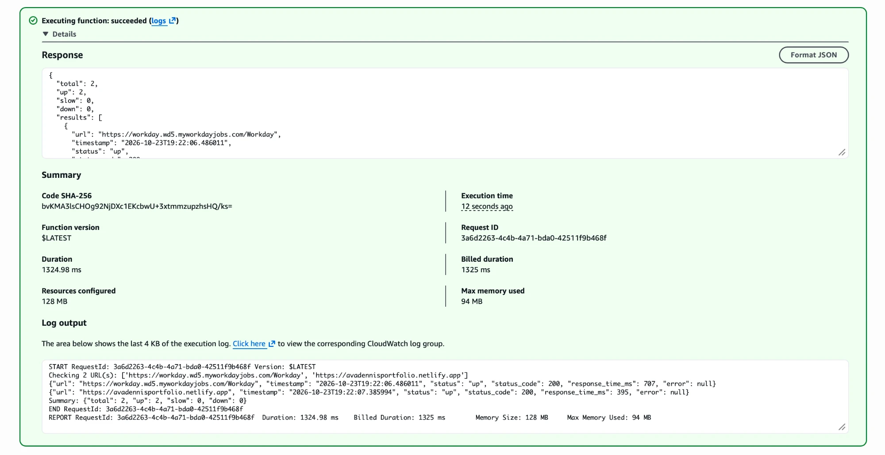

# AWS Uptime Monitor

A serverless uptime monitoring tool built on AWS. It checks one or more websites every 5 minutes, logs results to CloudWatch, and sends an email alert via SNS if any site is down or responding slowly.

---

## Architecture

```
EventBridge Scheduler (every 5 min)
        |
        v
  AWS Lambda (Python)
   |           |
   v           v
CloudWatch   SNS Topic
  Logs &      |
  Metrics     v
           Email Alert
```

**Flow:**
- An EventBridge Scheduler schedule triggers the Lambda function every 5 minutes
- Lambda loops through all configured URLs and pings each one
- Results (status, response time, status code) are logged to CloudWatch Logs
- `SiteUp` (1/0) and `ResponseTimeMs` metrics are pushed to CloudWatch Metrics
- If any site is `down` or `slow`, a single summary alert is sent via SNS to your email

---

## Services Used

| Service | Purpose |
|---|---|
| **AWS Lambda** | Runs the Python checker function — no server needed |
| **Amazon EventBridge Scheduler** | Triggers Lambda on a fixed `rate(5 minutes)` schedule |
| **Amazon SNS** | Sends email notifications when a site is down or slow |
| **Amazon CloudWatch Logs** | Stores every check result for debugging and history |
| **Amazon CloudWatch Metrics** | Tracks uptime and response time trends over time |
| **AWS IAM** | Grants Lambda permission to write to CloudWatch and publish to SNS |

All services used are within the **AWS Free Tier**.

---

## Results

The monitor ran continuously from **March 2 to September 2, 2026**, checking two sites every 5 minutes (288 checks per site per day):

- `https://avadennisportfolio.netlify.app` — my portfolio site
- `https://workday.wd5.myworkdayjobs.com/Workday` — a large third-party site for comparison

**Uptime and response time, Mar–Sep 2026** (daily averages):



- Both sites stayed up for well over 99.9% of checks.
- My portfolio (green) averaged well under 100 ms, while Workday (blue) averaged around 500–600 ms. Netlify serves the site from a CDN edge close to the checker, so it responds much faster.

**Uptime, zoomed in** (right axis shows 0.99–1 only):



Each dip is a day where roughly 2–3 of the 288 checks failed. The portfolio dipped three times in six months; Workday dipped more often.

**Individual checks, Aug 25–27** (5-minute resolution):



At full resolution, the portfolio shows periodic latency spikes (~500 ms+) on top of its normal fast responses, and there is a single failed Workday check on Aug 26.

### Investigating the latency spikes

An AI assistant suggested Lambda cold starts as a possible cause, so I investigated that. On a cold start, the first URL in the list absorbs extra setup time (Python loading SSL certificates, fresh DNS lookups). A test run right after a cold start confirmed this (`Init Duration: 483 ms`, Workday checked first at 1037 ms, portfolio second at 61 ms).

But the portfolio is checked **second**, so cold starts don't explain its spikes. The more likely cause is CDN cache misses on Netlify's side, where a request occasionally goes back to origin instead of being served from the edge cache.

### Alerting, end to end

A test with a deliberately non-existent domain shows the whole alert path: the check fails, Lambda logs it, publishes to SNS, and an email arrives.







Note: inside Lambda, a failed DNS lookup surfaces as `[Errno 16] Device or resource busy` rather than the usual "Name or service not known", which is a confusing message to receive in an alert.

---

## How to Deploy

### Prerequisites
- AWS account (free tier)
- AWS CLI installed and configured (`aws configure`)

### Step 1 — Create an SNS Topic for email alerts
1. Go to **AWS Console > SNS > Topics > Create topic**
2. Type: Standard, Name: `uptime-alerts`
3. Create a **subscription**: Protocol = Email, enter your email
4. Confirm the subscription from your inbox
5. Copy the **Topic ARN** (you'll need it in Step 3)

### Step 2 — Create an IAM Role for Lambda
1. Go to **IAM > Roles > Create role**
2. Trusted entity: AWS service > Lambda
3. Attach these policies:
   - `AWSLambdaBasicExecutionRole` (CloudWatch Logs)
   - `CloudWatchFullAccess` (custom metrics)
   - `AmazonSNSFullAccess` (send alerts)
4. Name it: `lambda-uptime-monitor-role`

> These managed policies are broader than the function needs. The function only calls `cloudwatch:PutMetricData` and `sns:Publish` (on one topic), so a least-privilege setup would replace the two `FullAccess` policies with a small custom policy scoped to those actions.

### Step 3 — Create the Lambda Function
1. Go to **Lambda > Create function**
2. Name: `uptime-monitor`, Runtime: Python 3.12 or newer
3. Permissions: use existing role > `lambda-uptime-monitor-role`
4. Paste the contents of `lambda_function.py` into the code editor
5. Go to **Configuration > Environment Variables** and add:

| Key | Value |
|---|---|
| `URLS` | `https://yoursite.com,https://google.com` |
| `SNS_TOPIC_ARN` | `arn:aws:sns:us-east-1:xxxx:uptime-alerts` |
| `TIMEOUT_SECONDS` | `10` |
| `SLOW_THRESHOLD_MS` | `3000` |

6. Set timeout to **30 seconds** (Configuration > General)

### Step 4 — Add a Schedule Trigger
1. In your Lambda function, click **Add trigger**
2. Select **EventBridge Scheduler**
3. Create a schedule named `uptime-monitor-schedule`:
   - Schedule expression: `rate(5 minutes)`
4. Make sure the schedule state is **Enabled**

### Step 5 — Test It
1. Click **Test** in the Lambda console
2. Use an empty JSON payload `{}`
3. Check the **Logs** tab to see results
4. To test alerting: temporarily add `https://thissitedoesnotexist12345.com` to `URLS`, run a test, then remove it



---

## Environment Variables

| Variable | Default | Description |
|---|---|---|
| `URLS` | `https://example.com` | Comma-separated list of URLs to monitor |
| `SNS_TOPIC_ARN` | *(empty)* | ARN of your SNS topic for alerts |
| `TIMEOUT_SECONDS` | `10` | How long to wait before marking a site as down |
| `SLOW_THRESHOLD_MS` | `3000` | Response time (ms) above which a site is flagged as slow |

---

## What I Learned

- **Serverless architecture** — how Lambda functions run on demand without managing servers. Thats something AWS takes care of
- **Event-driven design** — using EventBridge to trigger workloads on a schedule, similar to a cron job but i used a fixed rate
- **Observability fundamentals** — the difference between logs (what happened) and metrics (trends over time). I can see how looking at trends can show site reliability.
- **Alerting systems** — how SNS decouples alert generation from delivery, and why that matters at scale. It matters because you can add and remove recipients without redeploying code and it goes to everyone on the list topic.
- **IAM and least-privilege** — why every AWS resource needs explicit permissions and how roles work. AWS is API-driven, and every API call is authorized against IAM/security policies to determine whether it’s allowed. 


---

## Project Structure

```
aws-uptime-monitor/
├── lambda_function.py   # Core Lambda handler
├── docs/screenshots/    # Results and console screenshots
└── README.md            # This file
```

---

## Future Improvements

- Add Terraform to provision all infrastructure as code
- Store URL list in AWS SSM Parameter Store for easier updates without redeploying
- Add multi-region checks to detect regional outages
- Build a CloudWatch Dashboard to visualize uptime history
- Replace the `FullAccess` IAM policies with a least-privilege custom policy
- Report DNS failures with a clear message instead of `[Errno 16] Device or resource busy`
- Add a CloudWatch alarm on `ResponseTimeMs` to catch latency regressions
- Add SSL certificate expiry checks